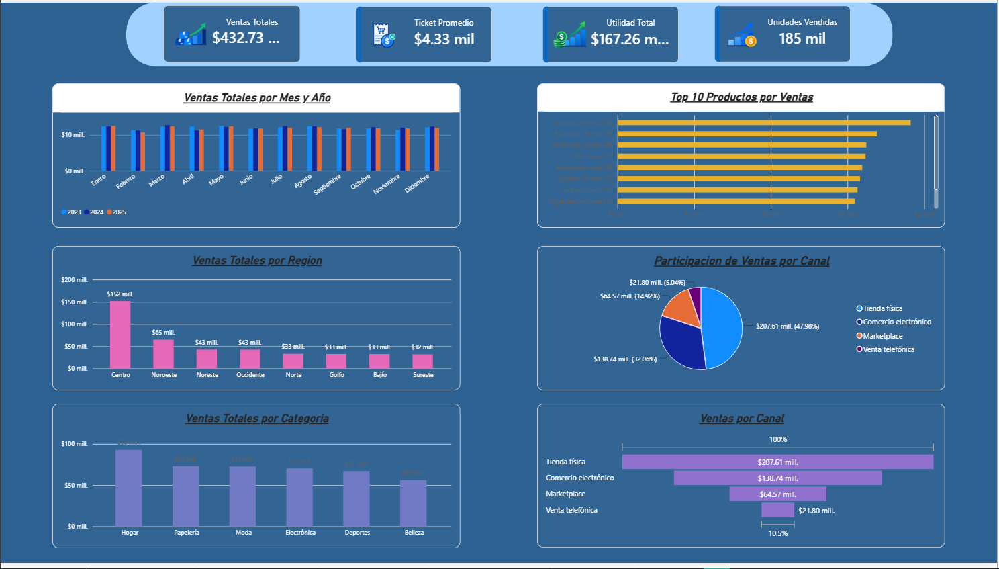
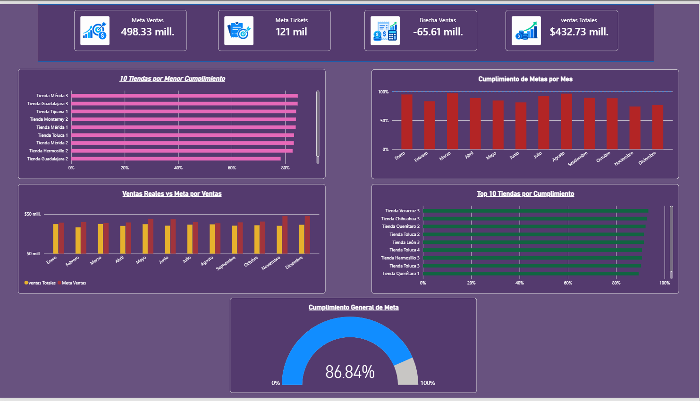
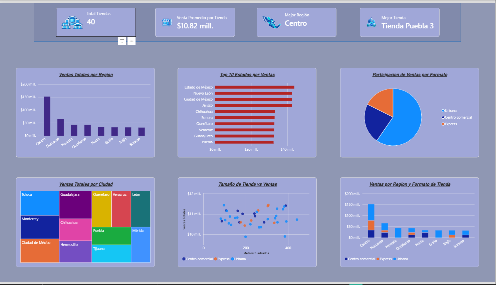
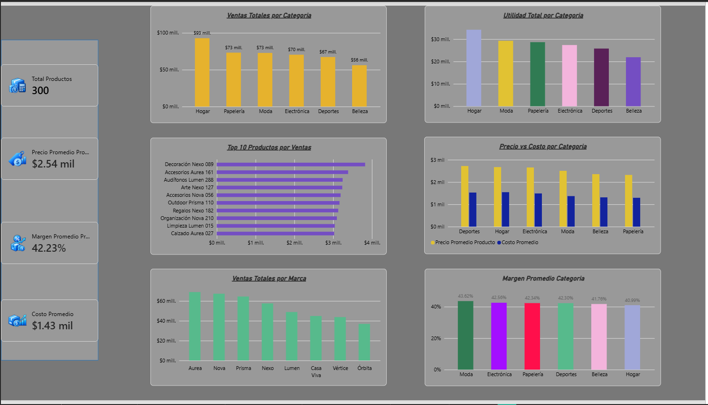
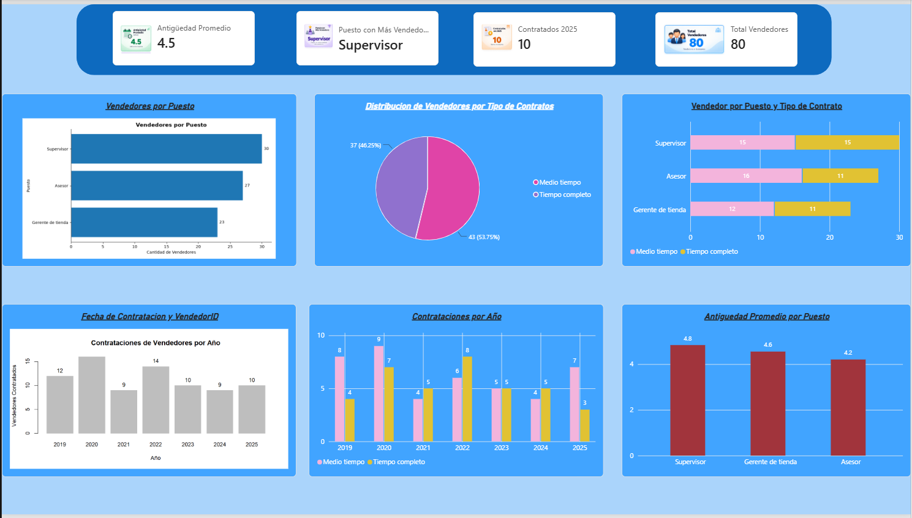
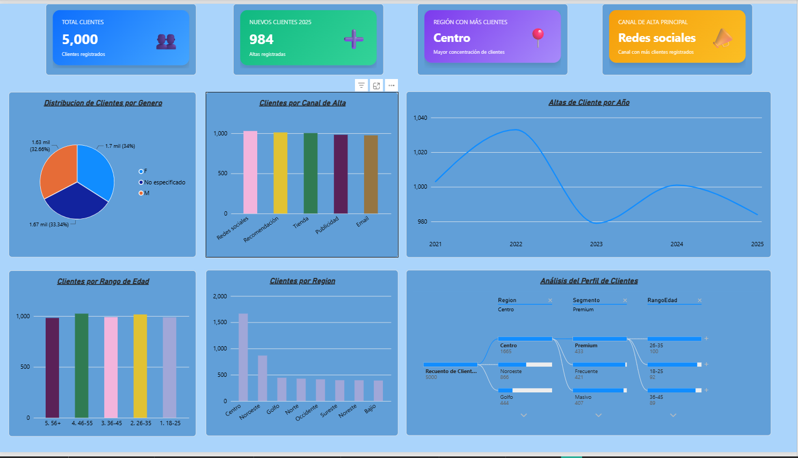

# Dashboard de ventas | Power BI

Proyecto de análisis y visualización de datos desarrollado por **David Aldana**.

## Objetivo

Analizar las ventas, las metas comerciales y su cumplimiento mediante indicadores y visualizaciones interactivas que faciliten la exploración del desempeño comercial.

## Contenido del repositorio

- **ventas.pbix:** archivo del reporte para abrir en Power BI Desktop.
- **ventas-01.png a ventas-06.png:** capturas de las páginas del reporte.

## Vista previa

### Página 1

### Página 2

### Página 3

### Página 4

### Página 5

### Página 6

## Cómo explorar el proyecto

Puedes consultar las capturas directamente en esta página.

Para explorar el reporte interactivo:

1. Descarga el archivo ventas.pbix.
2. Ábrelo con Power BI Desktop.
3. Recorre las páginas y utiliza los filtros disponibles.

Para actualizar los datos, puede ser necesario configurar las conexiones a las fuentes originales.

## Autor

**David Aldana**  
[Perfil de GitHub](https://github.com/david33-tech)
